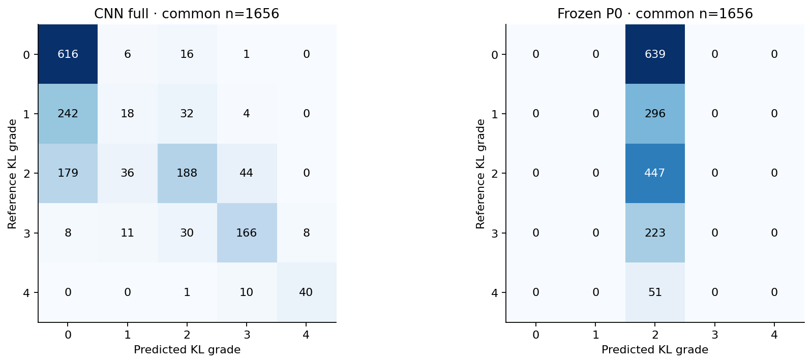

# Knee OA grading: compact vision–language model versus ResNet-18

Research code and recorded results for Sepideh Azadian's Master Thesis Project
at the University of Europe for Applied Sciences, Potsdam.

The study compares direct five-grade Kellgren–Lawrence (KL 0–4) classification
using **Qwen2.5-VL-3B-Instruct** and **ResNet-18** on a fixed public knee X-ray
benchmark. It evaluates grading, prompt and demonstration sensitivity,
limited-label LoRA adaptation, calibration, selective prediction, perturbation
controls and computational cost on a Kaggle Tesla T4.

**Status:** the recorded study completed on 18 November 2026. The repository
contains the complete available notebook, a CPU reproduction path and the
unchanged analysis output ZIP. The publication notebook includes documented
resume/export improvements. The exact final executed, resumed Kaggle notebook
was not present in the output backups; see [source provenance](docs/SOURCE_PROVENANCE.json).

## Main recorded results

All eight configurations completed all **1,656** eligible held-out test cases.
These are measurements from this run, not expected values or simulated results.

| Configuration | Test accuracy | QWK | Macro F1 | KL1 recall | Mean warm time / image |
|---|---:|---:|---:|---:|---:|
| ResNet-18, full training split | 62.08% | 0.7422 | 0.5811 | 6.08% | 4.73 ms |
| ResNet-18, 20% of training groups | 40.70% | 0.5535 | 0.4212 | 35.81% | 4.67 ms |
| Frozen VLM, minimal prompt P0 | 26.99% | 0.0000 | 0.0850 | 0.00% | 278.41 ms |
| Frozen VLM, rubric P1 | 38.89% | 0.0291 | 0.1281 | 0.00% | 302.47 ms |
| Frozen VLM, rubric + five examples S1 | 24.82% | 0.0438 | 0.1197 | 0.00% | 1,027.00 ms |
| Frozen VLM, sensitivity examples S2 | 26.99% | 0.0135 | 0.1025 | 0.00% | 1,026.88 ms |
| Frozen VLM, sensitivity examples S3 | 27.05% | 0.0059 | 0.0976 | 0.00% | 1,029.46 ms |
| VLM + LoRA, 20% of training groups | 40.64% | 0.1382 | 0.1651 | 0.00% | 295.50 ms |

Quality uses the full test cohort. Runtime uses a separate fixed 100-group
cohort with three timed repeats, batch size one, warm models and synchronization
instrumentation. Loading and target disk reads are separate; support images
are processed on each attempt. Hardware and measurement boundaries matter.

The primary contrast is **QWK(P0) − QWK(full CNN) = −0.7422**, with a paired
provisional-prefix bootstrap 95% interval of **[−0.7694, −0.7125]**.
The frozen P0 VLM selects KL2 for every test image. High completion therefore
does not demonstrate useful grading.



See [interpretation and limitations](docs/RESULTS.md), the
[table and figure index](docs/OUTPUT_INDEX.md), and the
[recorded CSV tables](results/tables).

## Check the recorded results — no GPU or dataset download

Clone or download this repository, enter its directory, and run:

```bash
python scripts/verify_results.py
```

This command uses only Python's standard library. It checks archive integrity,
194 output hashes, the available frozen files, test identities and labels,
probabilities, independently recomputed metrics, timing summaries, browsable
result copies and notebook syntax. Three trained weight files are intentionally
absent from the public analysis archive.

To regenerate all numerical analyses and figures from the saved predictions:

```bash
python -m venv .venv
# Linux/macOS:
source .venv/bin/activate
# Windows PowerShell instead: .venv\Scripts\Activate.ps1
python -m pip install -r requirements-analysis.txt
python scripts/reproduce_analysis.py --output reproduced
```

The CPU analysis does not load model weights or contact a model API. It
regenerates **Tables 5–18 and Figures 1–14** with the recorded 2,000 bootstrap
resamples and compares the tables and secondary contrasts to the original
snapshot. Use a new output directory for each run. Plot bytes may differ across
font/rendering environments; numerical outputs are compared with explicit
tolerances. See [reproduction instructions](docs/REPRODUCING.md).

The repository preparation check regenerated all seven research questions:
**14 numbered tables and six primary/secondary contrast files matched** the
recorded results. See [validation evidence](docs/VALIDATION.md). Training and
GPU inference were not repeated during repository preparation.

For a manual GitHub upload, follow [docs/GITHUB_SETUP.md](docs/GITHUB_SETUP.md).

## Run the full models on Kaggle

Import [notebooks/Knee_OA_Study.ipynb](notebooks/Knee_OA_Study.ipynb) into Kaggle,
attach the [source dataset](https://www.kaggle.com/datasets/shashwatwork/knee-osteoarthritis-dataset-with-severity),
enable Internet for dependency/model downloads and select a GPU accelerator.
The original run used a Tesla T4.

For a **new** study, run the notebook in order in `mode='study'`; section 5a is
pilot-only. The default reproduction directory is separate from the completed
study. The publication notebook pins the recorded base-model revision.
Do not rerun training merely to inspect the saved results.

For an existing **full backup**, use the resume workflow in
[docs/REPRODUCING.md](docs/REPRODUCING.md). The analysis ZIP alone cannot resume
model inference because it omits trained weights.

## What is included

| Location | Contents |
|---|---|
| `notebooks/Knee_OA_Study.ipynb` | Complete Kaggle preparation, training, freeze, test, RQ1–RQ7 and export pipeline |
| `src/knee_oa/analysis.py` | CPU versions of the notebook's numerical analysis functions |
| `scripts/` | Integrity/metric verification, cached analysis reproduction, private full backup |
| `artifacts/Knee_OA_study_outputs.zip` | Unchanged 195-file analysis snapshot: predictions, scores, logs, audit and frozen protocol |
| `results/tables/`, `results/figures/` | Browsable copies of all final tables and figures |
| `results/protocol/` | Key recorded settings, prompts, revision, temperatures and thresholds |
| `docs/` | Methods, data access, reproduction, results, provenance and validation evidence |
| `.github/workflows/verify.yml` | CPU-only integrity and metric checks on GitHub Actions |
| `CITATION.cff` | Citation metadata for the repository |

The 15.43 MiB analysis ZIP is tracked deliberately. Raw radiographs, pretrained
base weights and trained CNN/LoRA weights are excluded. Keep the full study
backup privately for cross-session recovery. Dependencies and third-party
materials retain their own terms; see [THIRD_PARTY_NOTICES.md](THIRD_PARTY_NOTICES.md)
and [LICENSE](LICENSE).

## Scope

This is an engineering benchmark of current radiographic KL grading. Grouping
uses provisional seven-digit filename prefixes; participant independence and
reader/visit linkage were not established. There are 150,002 cross-split dHash
screening flags, without automatic exclusions or relabeling. Foundation-model
pretraining exposure cannot be excluded. The intervals do not estimate
run-to-run training variation. There is no external or patient-care validation.

## Cite in a thesis

Use the repository URL together with a fixed release or commit identifier in
the thesis's **Code availability** section. GitHub's **Cite this repository**
control reads `CITATION.cff`. See [docs/CITATION.md](docs/CITATION.md) for a citation
and availability statement. A DOI is not assigned by this repository.
